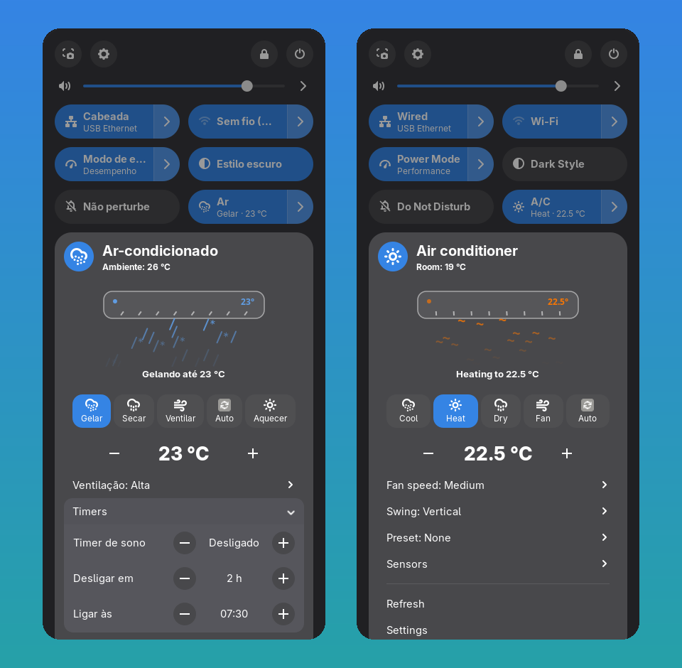
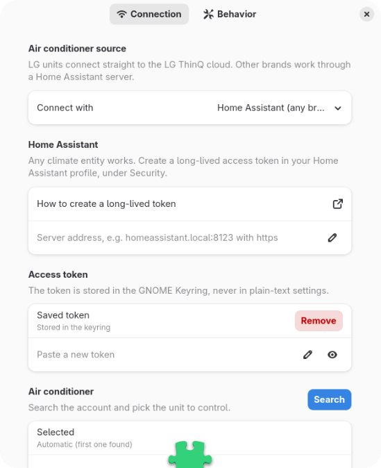

<p align="center">
  
</p>

<h1 align="center">Brisa</h1>

<p align="center">
  <b>Your air conditioner in GNOME Quick Settings</b>, with a live animation of what it is doing right now.<br>
  <a href="https://lciarallo.github.io/brisa/">Website</a> ·
  <a href="README.pt-BR.md">Português</a> ·
  <a href="SECURITY.md">Security</a> ·
  <a href="LICENSE">GPL-3.0-or-later</a>
</p>

<p align="center">
  
</p>

## Features

- **One click** turns the unit on or off. The toggle shows the mode and target temperature, and the top bar shows the target while it runs.
- **Live animation** of the indoor unit. The airflow colour follows the mode (cool, heat, dry, fan, auto). The flow speed follows the fan setting, the vanes sweep while swing is on, and the flow calms down when the unit is idle. It only animates while the menu is open.
- **Mode buttons**: picking a mode while the unit is off turns it on in that mode.
- **Temperature stepper**: several clicks are grouped into a single request.
- **Everything the unit supports**, read from the device itself: fan speed, swing, presets, air direction, energy saving, display light, purification, timers (sleep, *turn off in*, *turn on at*) and sensors (room temperature, humidity, PM2.5, filter life).
- **Automatic capability detection**: controls come from what the unit itself reports. That includes per-mode limits: many LG units only take a setpoint in Cool mode, so the stepper is disabled in Fan and Dry. Detection runs again on *Refresh*, every 6 hours, and when the unit rejects a command as unsupported. For Home Assistant it follows the entity's `supported_features` and reacts as soon as they change.
- **Settings window**: pick the provider, store the token, search the account, choose the unit and see the **detected functions** before using it.
- **Translations**: English and Brazilian Portuguese.

<p align="center">
  
</p>

## Supported air conditioners

| Brand | How |
|---|---|
| **LG** (ThinQ app) | Directly through LG's official **ThinQ Connect** cloud API with a Personal Access Token. |
| **Any other brand** | Through **[Home Assistant](https://www.home-assistant.io/)**: every `climate.*` entity works. That covers Samsung (SmartThings), Midea, Gree, Daikin, Fujitsu, Panasonic, Tuya, Sensibo, Broadlink IR blasters and many more. |

Why not SmartThings directly? Since early 2025, new SmartThings personal tokens expire after 24 hours. That makes a desktop widget impractical without an OAuth backend. Home Assistant's SmartThings integration handles that for you.

## Install

### From extensions.gnome.org

*Coming soon.* Brisa has not been submitted yet. Once it is listed, you will be able to install it from the website or the **Extension Manager** app.

### From source

```bash
git clone https://github.com/Lciarallo/brisa.git
cd brisa
make install
```

Log out and back in (Wayland), then enable **Brisa** in *Extensions*. Requires GNOME 47–50.

## Set up

1. Open **Extensions → Brisa → Settings**, or click *Set up connection…* in the menu.
2. Choose **LG ThinQ** or **Home Assistant**.
3. **LG**: create a token at <https://connect-pat.lgthinq.com> with the account you use in the ThinQ app, and check the account's country.
   **Home Assistant**: enter the server address and create a *long-lived access token* in your HA profile → *Security*.
4. Paste the token and press ✓. It goes straight into the **GNOME Keyring**.
5. Press **Search** and pick your unit (or leave it on *Automatic*).

## Security and privacy

- Tokens are kept in the GNOME Keyring through libsecret, never in GSettings/dconf.
- HTTPS only, with normal certificate checks. Plain `http://` is accepted only for Home Assistant on your local network, and the settings warn you about it.
- Redirects are never followed, so the token is never replayed to another host. Responses are capped at 8 MB, and every value used in a URL is validated.
- No telemetry, no logs of your device. Brisa only talks to the LG cloud or to your Home Assistant server.

The full threat model is in [SECURITY.md](SECURITY.md).

## How the LG integration was built

The LG endpoints, headers and payloads were mapped with the **REA** reverse-engineering toolkit. REA inspected LG's own open-source client [`thinqconnect`](https://pypi.org/project/thinqconnect/) (Apache-2.0). No private API is used; this is the same ThinQ Connect API LG publishes for developers.

| Action | Request |
|---|---|
| Devices | `GET https://api-{kic,aic,eic}.lgthinq.com/devices` |
| Capabilities | `GET /devices/{id}/profile` |
| State | `GET /devices/{id}/state` |
| Power | `POST /devices/{id}/control` `{"operation":{"airConOperationMode":"POWER_ON"}}` |
| Mode | `{"airConJobMode":{"currentJobMode":"COOL"}}` |
| Temperature | `{"temperatureInUnits":{"targetTemperature":23,"unit":"C"}}` |
| Fan | `{"airFlow":{"windStrength":"HIGH"}}` |
| Swing | `{"windDirection":{"rotateUpDown":true}}` |
| Sleep timer | `{"sleepTimer":{"relativeHourToStop":2,"relativeMinuteToStop":0}}` |
| Turn on at 07:30 | `{"timer":{"absoluteHourToStart":7,"absoluteMinuteToStart":30}}` (`-1,-1` clears it) |

## Development

```bash
make            # compile schemas and translations
make install    # link into ~/.local/share/gnome-shell/extensions
make pot        # refresh po/*.pot and merge translations
make pack       # build dist/brisa@lciarallo.github.io.shell-extension.zip
```

Layout: `providers/` (LG ThinQ, Home Assistant), `lib/` (HTTP and keyring), `ui/` (menu widgets and the animation), `po/` (translations), `docs/` (website).

To add a provider, implement `listDevices`, `open` (returns capabilities), `getState` and the `set*` methods, then register it in `providers/index.js`.

## Contributing

Pull requests, translations and device reports are welcome. See [CONTRIBUTING.md](CONTRIBUTING.md). Questions and ideas go to [Discussions](https://github.com/Lciarallo/brisa/discussions).

## License

Copyright © 2026 Luiz Eduardo Ciarallo.
Brisa is free software under the **GNU General Public License v3.0 or later** ([LICENSE](LICENSE)).

"LG" and "ThinQ" are trademarks of LG Electronics. "Home Assistant" is a trademark of the Open Home Foundation. Brisa is an independent project and is not affiliated with or endorsed by them.
