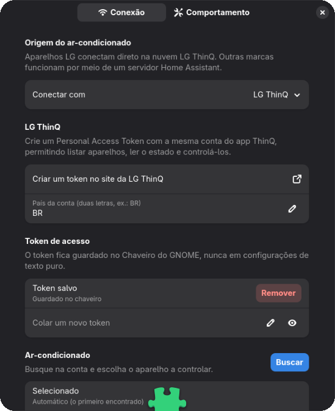

<p align="center">
  
</p>

<h1 align="center">Brisa</h1>

<p align="center">
  <b>Seu ar-condicionado nas Configurações Rápidas do GNOME</b>, com uma animação ao vivo do que ele está fazendo agora.<br>
  <a href="https://lciarallo.github.io/brisa/">Site</a> ·
  <a href="README.md">English</a> ·
  <a href="SECURITY.md">Segurança</a> ·
  <a href="LICENSE">GPL-3.0-or-later</a>
</p>

<p align="center">
  
</p>

## O que ela faz

- **Liga e desliga com um clique.** O botão mostra o modo e a temperatura alvo, e a barra superior mostra a temperatura enquanto o ar está ligado.
- **Animação ao vivo** do aparelho:
  - a cor do vento segue o modo (gelar, aquecer, secar, ventilar, auto);
  - a velocidade segue a ventilação;
  - as aletas oscilam quando a oscilação está ligada;
  - o fluxo diminui quando o ar está em pausa.

  Ela só roda com o menu aberto.
- **Botões de modo**: escolher um modo com o ar desligado já liga nesse modo.
- **Temperatura com − / +**: vários cliques viram um único comando.
- **Tudo o que o seu aparelho suporta**, lido do próprio aparelho:
  - ventilação, oscilação, predefinições e direção do vento;
  - economia de energia, luz do display e purificação;
  - timers (sono, *desligar em*, *ligar às*);
  - sensores (temperatura ambiente, umidade, PM2,5, vida do filtro).
- **Detecção automática das funções**: os controles vêm do que o próprio aparelho informa, inclusive limites por modo. Muitos ares LG só aceitam temperatura no modo Gelar, então o − / + fica desativado em Ventilar e Secar. A detecção roda de novo ao clicar em *Atualizar*, a cada 6 horas e quando o aparelho recusa um comando por não suportá-lo. No Home Assistant, ela segue o `supported_features` da entidade e reage assim que ele muda.
- **Janela de configurações**: escolha o provedor, salve o token, busque na conta, escolha o aparelho e veja as **funções detectadas** antes de usar.
- **Idiomas**: português do Brasil e inglês.

<p align="center">
  
</p>

## Aparelhos compatíveis

| Marca | Como |
|---|---|
| **LG** (app ThinQ) | Direto pela API oficial **ThinQ Connect** da LG, com um Personal Access Token. |
| **Qualquer outra marca** | Pelo **[Home Assistant](https://www.home-assistant.io/)**: toda entidade `climate.*` funciona. Inclui Samsung (SmartThings), Midea/Springer, Elgin, Gree, Daikin, Fujitsu, Panasonic, Tuya, Sensibo, controles IR Broadlink e muitas outras. |

**Por que não SmartThings direto?** Desde 2025, os tokens pessoais novos do SmartThings expiram em 24 h. A integração do Home Assistant resolve isso com OAuth.

## Instalação

### Pela loja (extensions.gnome.org)

*Em breve.* A Brisa ainda não foi enviada. Quando estiver publicada, dá para instalar pelo site ou pelo app **Gerenciador de Extensões**.

### Pelo código-fonte

```bash
git clone https://github.com/Lciarallo/brisa.git
cd brisa
make install
```

Saia da sessão e entre de novo (Wayland), depois ative **Brisa** em *Extensões*. Requer GNOME 47 a 50.

## Configuração

1. Abra **Extensões → Brisa → Configurações**, ou clique em *Configurar conexão…* no menu.
2. Escolha **LG ThinQ** ou **Home Assistant**.
3. **LG**: crie um token em <https://connect-pat.lgthinq.com> com a conta do app ThinQ e confira o país da conta.
   **Home Assistant**: informe o endereço do servidor e crie um *token de acesso de longa duração* em Perfil → Segurança.
4. Cole o token e clique em ✓. Ele vai direto para o **Chaveiro do GNOME**.
5. Clique em **Buscar** e escolha o aparelho (ou deixe em *Automático*).

## Segurança e privacidade

- **Tokens** ficam no Chaveiro do GNOME (libsecret), nunca no dconf/GSettings.
- **Conexões só por HTTPS**, com verificação de certificado. `http://` só é aceito para Home Assistant na rede local, com aviso.
- **O token não vaza para outro servidor**: redirecionamentos são recusados.
- **Limites**: respostas acima de 8 MB são recusadas, e todo valor usado em URL é validado.
- **Sem telemetria e sem registros do seu aparelho.**

Detalhes em [SECURITY.md](SECURITY.md).

## Como a integração LG foi feita

Os endpoints, cabeçalhos e payloads da LG foram mapeados com o **REA**, analisando o cliente oficial e aberto da própria LG, [`thinqconnect`](https://pypi.org/project/thinqconnect/) (Apache-2.0). É a mesma API ThinQ Connect que a LG publica para desenvolvedores, sem nenhuma API privada. A tabela completa de requisições está no [README em inglês](README.md#how-the-lg-integration-was-built).

## Desenvolvimento

```bash
make            # compila esquemas e traduções
make install    # cria o link em ~/.local/share/gnome-shell/extensions
make pot        # atualiza o .pot e mescla as traduções
make pack       # gera o zip para a loja em dist/
```

## Licença

Copyright © 2026 Luiz Eduardo Ciarallo. Software livre sob a **GNU GPL v3.0 ou posterior** ([LICENSE](LICENSE)).

"LG" e "ThinQ" são marcas da LG Electronics, e "Home Assistant" é marca da Open Home Foundation. A Brisa é um projeto independente, sem vínculo com essas empresas.
